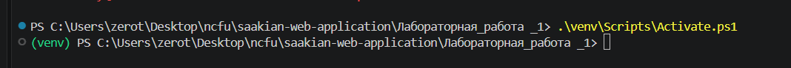
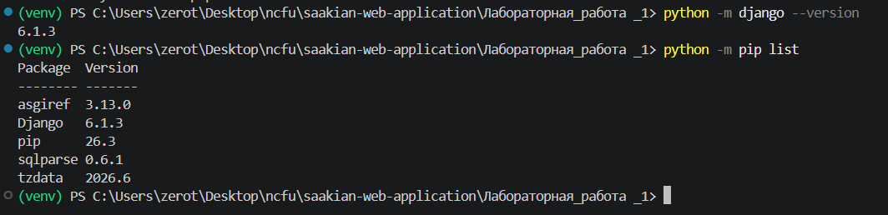
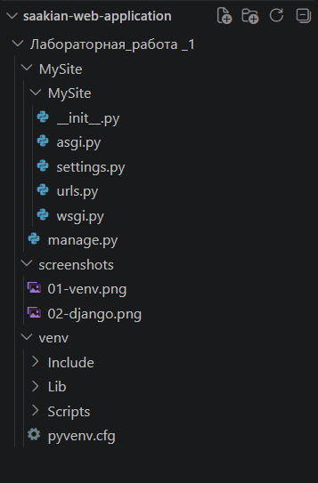
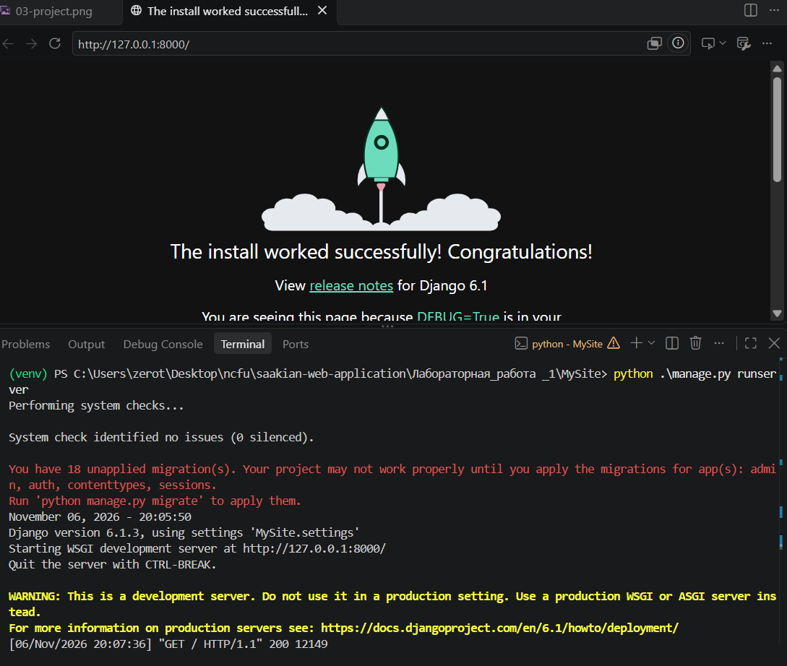
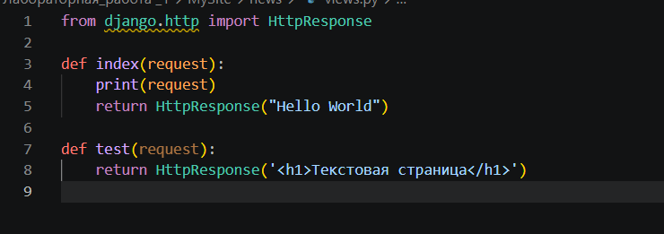
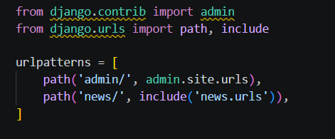
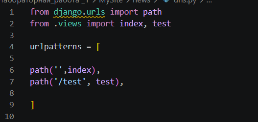
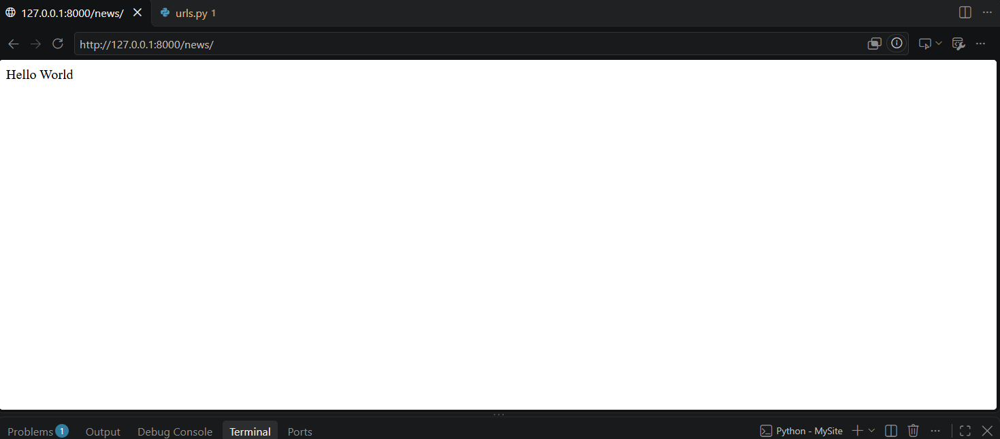
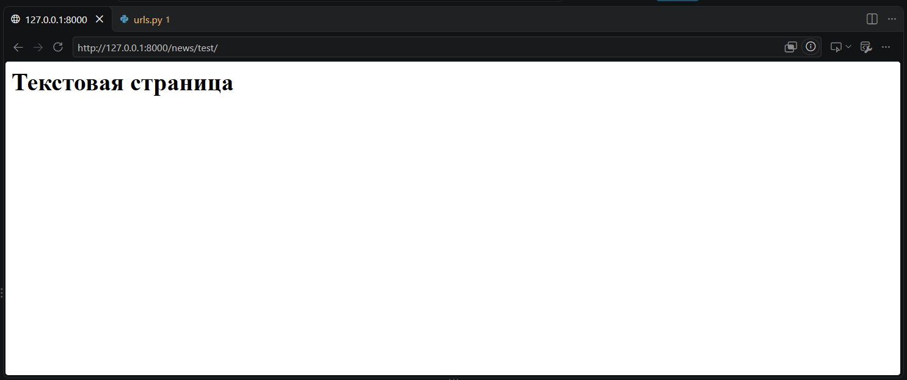

# Лабораторная работа № 1

## Создание виртуального окружения. Контроллеры и маршруты

**Дисциплина:** Разработка веб-приложений  
**Студент:** Саакян Аргишти Самвелович
**Группа:** ПИЖ-б-о-25-1 (2)
**Вариант:** 10  
**Среда разработки:** Visual Studio Code  
**Операционная система:** Windows 11  
**Язык программирования:** Python 3.12  
**Фреймворк:** Django

---

## Цель работы

Настроить виртуальное пространство, разработать контроллер приложения и организовать маршруты.

## Ход работы

### 1. Создание виртуального окружения

Для выполнения лабораторной работы была создана папка `Лабораторная_работа_1` внутри репозитория `saakian-web-application`.

В терминале Visual Studio Code было создано виртуальное окружение с помощью команды:

```powershell
python -m venv venv
```

Для активации виртуального окружения была выполнена команда:

```powershell
.\venv\Scripts\Activate.ps1
```

После выполнения команды в терминале появилось обозначение `(venv)`, подтверждающее успешную активацию окружения.



### 2. Установка Django

После активации виртуального окружения был выполнен просмотр установленных библиотек:

```powershell
python -m pip list
```

Для установки веб-фреймворка Django использовалась команда:

```powershell
python -m pip install django
```

После установки была выполнена проверка версии Django:

```powershell
python -m django --version
```

В результате был установлен Django версии 6.1.3.



### 3. Создание Django-проекта

Для создания проекта использовалась команда:

```powershell
django-admin startproject MySite
```

После выполнения команды была создана папка `MySite`, содержащая основной файл управления проектом `manage.py` и пакет конфигурации.

Переход в директорию проекта осуществлялся командой:

```powershell
cd MySite
```

Основные файлы проекта:

- `manage.py` — управление проектом Django.
- `settings.py` — настройки проекта.
- `urls.py` — основной маршрутизатор.
- `asgi.py` — точка входа для ASGI-сервера.
- `wsgi.py` — точка входа для WSGI-сервера.



### 4. Запуск сервера Django

Для запуска встроенного сервера разработки была выполнена команда:

```powershell
python manage.py runserver
```

Сервер был запущен по локальному адресу:

`http://127.0.0.1:8000/`

При переходе по указанному адресу в браузере открылась стандартная стартовая страница Django, подтверждающая успешное создание проекта.



### 5. Создание приложения news

Для создания приложения `news` была выполнена команда:

```powershell
python manage.py startapp news
```

После выполнения команды в проекте появилась папка `news`, содержащая файлы приложения.

Чтобы зарегистрировать приложение в проекте, в файле `MySite/settings.py` в список `INSTALLED_APPS` была добавлена строка:

```python
'news.apps.NewsConfig',
```

Регистрация приложения необходима для подключения его компонентов к проекту Django.

Для локального запуска Django создаёт временный секретный ключ. При необходимости постоянный ключ можно передать через переменную окружения `DJANGO_SECRET_KEY`.

### 6. Разработка контроллеров

Для обработки HTTP-запросов в приложении используется файл `news/views.py`.

В данном файле были созданы две функции-контроллера: `index` и `test`.

```python
from django.http import HttpResponse


def index(request):
    print(request)
    return HttpResponse('Hello World')


def test(request):
    return HttpResponse('<h1>Текстовая страница</h1>')
```

Функция `index` принимает HTTP-запрос и возвращает текст `Hello World`.

Функция `test` возвращает HTML-разметку с заголовком первого уровня.

Класс `HttpResponse` используется для формирования HTTP-ответа, который Django отправляет клиенту.



### 7. Настройка маршрутизации

Маршрутизация позволяет сопоставлять URL-адреса с соответствующими функциями-контроллерами.

В главном файле `MySite/urls.py` была выполнена настройка подключения маршрутов приложения `news`.

```python
from django.contrib import admin
from django.urls import path, include

urlpatterns = [
    path('admin/', admin.site.urls),
    path('news/', include('news.urls')),
]
```

Функция `include()` позволяет подключать маршруты отдельного приложения.

В папке `news` был создан файл `urls.py` со следующим содержимым:

```python
from django.urls import path
from .views import index, test

urlpatterns = [
    path('', index),
    path('test/', test),
]
```

В результате были настроены два адреса:

- `/news/` — вызов функции `index`.
- `/news/test/` — вызов функции `test`.





### 8. Проверка главной страницы приложения

После настройки маршрутов был повторно запущен сервер разработки:

```powershell
python manage.py runserver
```

В браузере был открыт адрес:

`http://127.0.0.1:8000/news/`

В результате на странице отобразился текст:

```text
Hello World
```

Это подтверждает правильность работы функции `index` и настроенного маршрута.



### 9. Проверка тестовой страницы

Для проверки второго контроллера был открыт адрес:

`http://127.0.0.1:8000/news/test/`

В браузере отобразился заголовок:

**Текстовая страница**

Это подтверждает правильную работу контроллера `test` и вложенной маршрутизации.



---

## Результаты работы

В ходе выполнения лабораторной работы были получены следующие результаты:

1. Создано и активировано виртуальное окружение Python.
2. Установлен веб-фреймворк Django.
3. Создан Django-проект `MySite`.
4. Запущен встроенный сервер разработки.
5. Создано и зарегистрировано приложение `news`.
6. Разработаны контроллеры `index` и `test`.
7. Настроена маршрутизация с использованием `path()` и `include()`.
8. Проверена работа двух веб-страниц.

## Вывод

В ходе лабораторной работы были изучены основные принципы создания веб-приложений на Django. Было настроено виртуальное окружение Python, установлен фреймворк Django и создан проект с приложением `news`.

На практике освоены создание контроллеров, обработка HTTP-запросов с помощью `HttpResponse` и организация маршрутов через `path()` и `include()`.

В результате было создано работающее веб-приложение с двумя страницами, доступными по различным URL-адресам. Цель лабораторной работы достигнута.